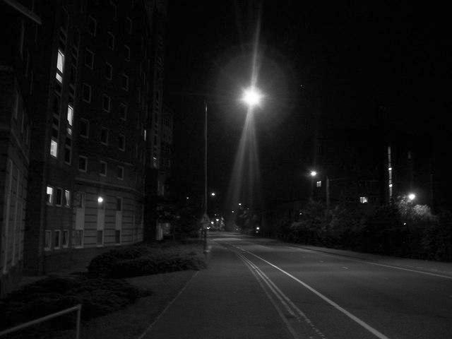
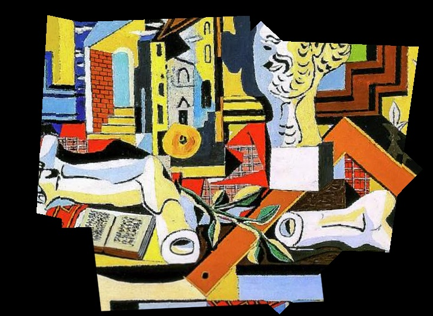
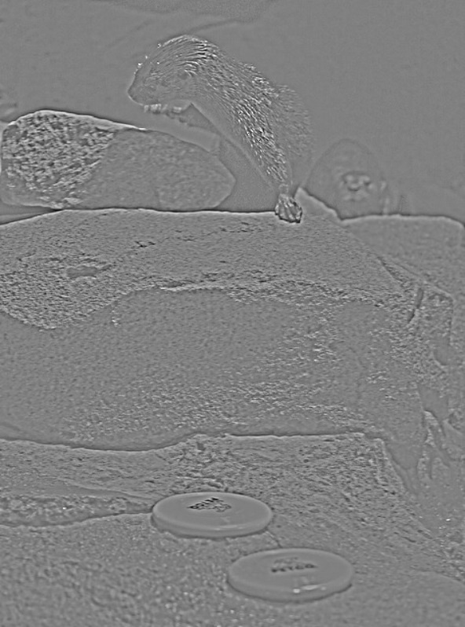
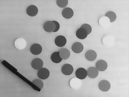
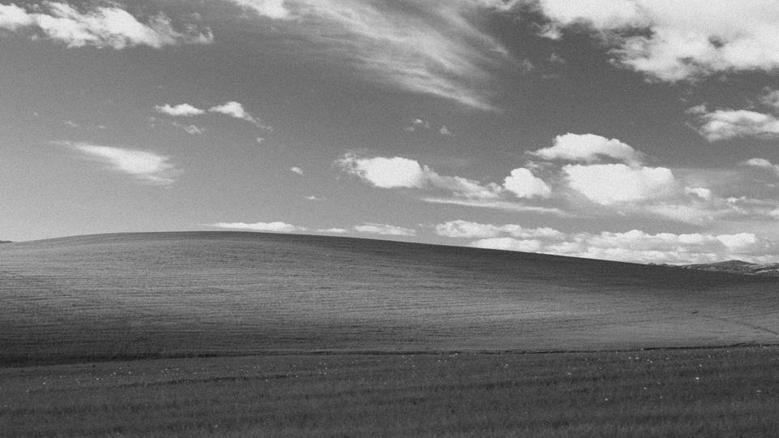
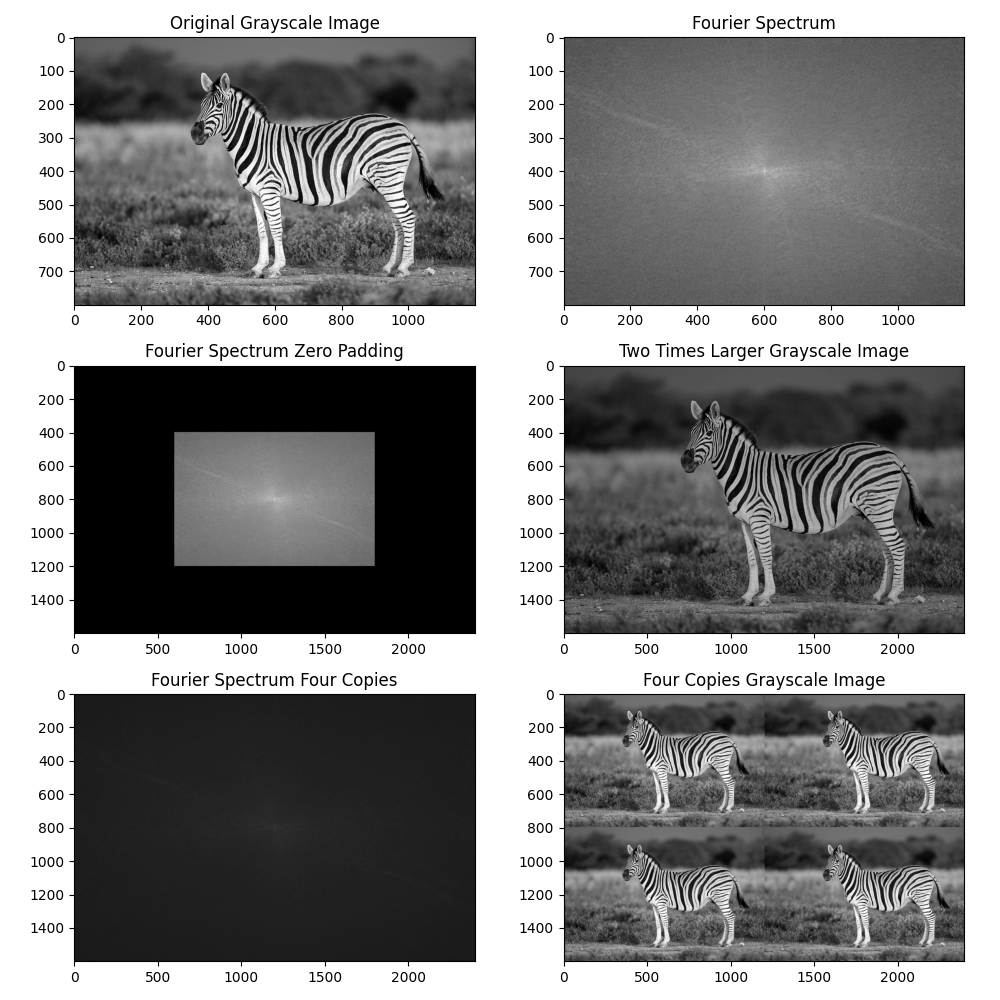
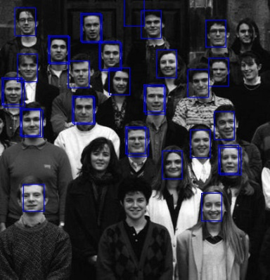
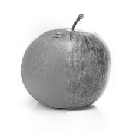
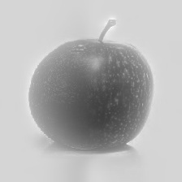

# Image Processing Coursework

This repository contains a collection of image-processing and computer-vision assignments completed in Python. The work focuses on practical techniques such as histogram analysis, image restoration, Fourier-domain processing, geometric transformations, template matching, and image blending.

## Repository structure

- `HW1/`
  - `TranscribeHistogram.py` — histogram-based image transcription and student counting
  - `HW1 - answers.pdf` — assignment report and solution summary
- `HW2/`
  - `q1/imageFix.py` — contrast enhancement and image fixing
  - `q2/puzzleSolver.py` — puzzle reconstruction using geometric transforms
  - `HW2 report.pdf` — assignment report
- `HW3/`
  - `q1/bonus.py` — filter experiments and MSE comparison
  - `q2/BilateralCleaning.py` — edge-preserving denoising
  - `q3/fixImg.py` — restoration with smoothing and averaging
  - `report.pdf` — assignment report
- `HW4/`
  - `q2/zebra.py` — Fourier-domain scaling and spectrum analysis
  - `q3/main.py` and `BadImagesFixing.py` — restoration of degraded images
  - `report.pdf` — assignment report
- `HW5/`
  - `q1/matchFaces.py` — template matching and detection
  - `q2/blendFruits.py` and `blend2.py` — Laplacian pyramid blending
  - `report.pdf` — assignment report

## Technologies used

- Python 3
- OpenCV (`cv2`)
- NumPy
- Matplotlib
- scikit-learn (`KMeans`)
- SciPy (`convolve`)

---

## HW1 — Histogram-based transcription

### `HW1/TranscribeHistogram.py`

This script reads images from `data` and `numbers`, converts them to grayscale, reduces their bit depth using K-means quantization, and compares cumulative histograms to identify the matching number pattern.

What it does:
- loads image folders and extracts grayscale images
- quantizes intensities using K-means clustering
- computes cumulative histograms for each image
- compares the target histogram against numbered reference histograms
- thresholds the image to isolate bar regions
- estimates bar heights and prints the final histogram outputs

This project demonstrates a basic image-recognition pipeline based on histogram comparison.

Assignment reference:
- [HW1 - answers.pdf](HW1/HW1%20-%20answers.pdf)

Screenshot:


---

## HW2 — Image enhancement and puzzle assembly

### `HW2/q1/imageFix.py`

This file corrects damaged or low-contrast images by applying image-enhancement techniques.

What it does:
- applies brightness and contrast stretching
- performs gamma correction
- uses histogram equalization
- saves corrected output images such as `1_fixed.jpg`, `2_fixed.jpg`, and `3_fixed.jpg`

Screenshot:



### `HW2/q2/puzzleSolver.py`

This script reconstructs puzzle pieces by aligning them using affine and perspective transforms.

What it does:
- reads matched points from `matches.txt`
- computes transform matrices with OpenCV
- warps each puzzle piece into the base image coordinate system
- stitches all pieces together to reconstruct the final puzzle
- saves the assembled result as `solution.jpg`

Screenshot:



---

## HW3 — Image filtering and restoration

### `HW3/q1/bonus.py`

This script applies many different filters to an image and compares them using Mean Squared Error (MSE).

What it does:
- applies horizontal/vertical averaging filters
- performs median blur and Gaussian-based filtering
- tests sharpening-style kernels
- evaluates filter quality numerically through MSE
- writes each filtered output to `filtered_image_1.jpg` ... `filtered_image_9.jpg`

Screenshot:



### `HW3/q2/BilateralCleaning.py`

This code denoises grayscale images while preserving edges using bilateral filtering.

What it does:
- extracts a local neighborhood around each pixel
- computes spatial and intensity weights
- applies weighted averaging to reduce noise without blurring edges
- writes denoised outputs for several example images

Screenshot:



### `HW3/q3/fixImg.py`

This script restores a damaged image using repeated smoothing and averaging.

What it does:
- applies median and Gaussian blur repeatedly
- smooths with a bilateral filter
- saves the intermediate fixed image
- averages multiple noisy versions of the image to reduce random noise
- writes the final result as `HQ_fix_.jpg`

Screenshot:



---

## HW4 — Fourier-domain processing and image restoration

### `HW4/q2/zebra.py`

This script works in the Fourier domain to analyze and resize the zebra image.

What it does:
- converts the image to grayscale
- computes the 2D FFT and visualizes the magnitude spectrum
- pads the Fourier spectrum to enlarge the image
- reconstructs the resized image using inverse FFT
- saves the final output as `zebra_scaled.png`

Screenshot:



### `HW4/q3/BadImagesFixing.py`

This file restores several degraded images using custom image-specific methods.

What it does:
- `clean_baby` uses perspective transformation and median filtering
- `clean_windmill` removes periodic artifacts via frequency-domain peak suppression
- `clean_watermelon` sharpens with a high-pass kernel
- `clean_umbrella` compensates for a frequency shift
- `clean_USAflag` preserves a region while smoothing the rest
- `clean_house` removes motion blur in the Fourier domain
- `clean_bears` improves contrast through histogram equalization

### `HW4/q3/main.py`

This script loads each degraded image from the `Images` folder and applies the appropriate fix, then displays the original and restored image side by side.

---

## HW5 — Pattern matching and image blending

### `HW5/q1/matchFaces.py`

This file detects a template image inside larger images using normalized cross-correlation.

What it does:
- scales the image and template to improve matching
- computes NCC across sliding windows
- removes duplicate detections with non-maximum suppression
- rescales found coordinates back to the original image size
- draws rectangles around detections and saves results

Screenshot:



### `HW5/q2/blendFruits.py`

This script blends two images using a Laplacian pyramid.

What it does:
- creates Laplacian pyramids for each image
- creates a mask that transitions from one image to the other
- combines the pyramid levels using the mask
- reconstructs the final blended image
- saves the result as `result.jpg`

Screenshot:



### `HW5/q2/blend2.py`

This is a second version of the image blending task using Gaussian/Laplacian pyramids and a mask.

What it does:
- loads both fruit images
- resizes them to match dimensions
- builds a blend mask
- blends matching pyramid levels
- reconstructs the final image and saves it as `blended.jpg`

Screenshot:



---

## Summary

This repository is a practical coursework collection covering the most important parts of digital image processing:
- enhancement and restoration
- denoising and filtering
- Fourier-domain analysis
- geometric transforms and stitching
- object/template detection
- pyramid-based multi-image blending

Together, these assignments provide a solid introduction to real-world computer vision workflows in Python.

## Running the code

Most scripts are intended to be run from the directory in which they are stored, with the relevant images available locally.

Examples:

```bash
cd HW1
python TranscribeHistogram.py
```

```bash
cd HW5/q2
python blendFruits.py
```

## License

No explicit license file is included in this repository. Please check with the repository owner before reusing or redistributing the code or assignment files beyond personal study.
